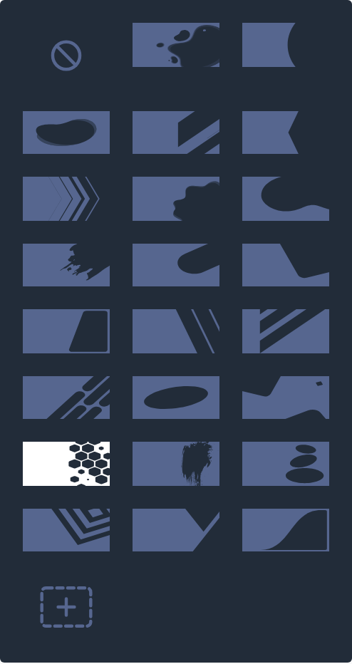
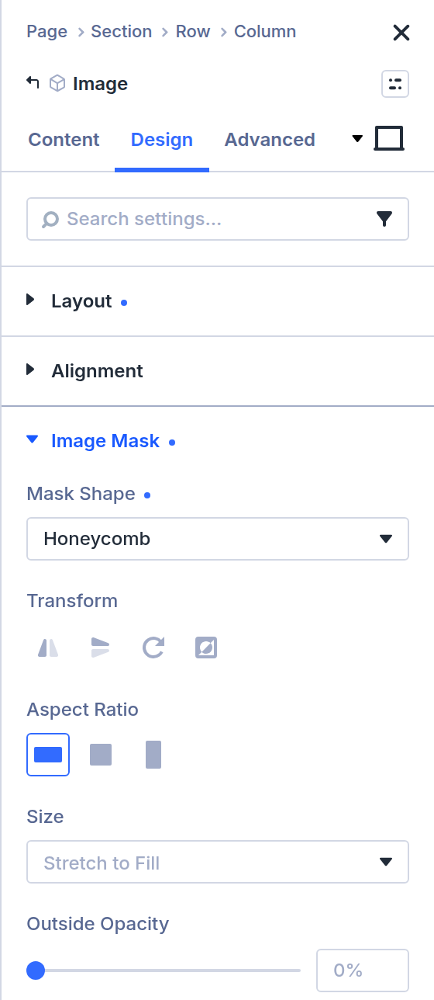
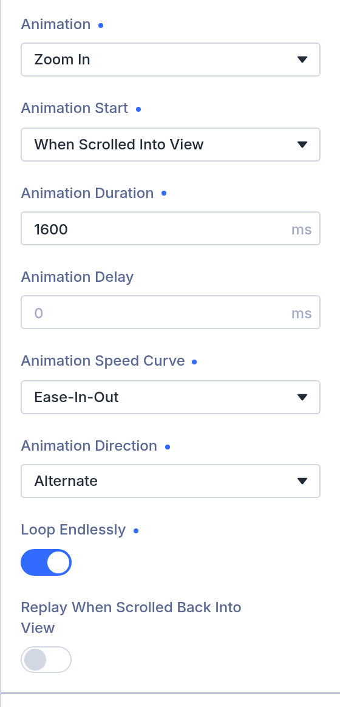

<h1 align="center">Image Mask for Divi 5</h1>

  
  

---

Small WordPress plugin that adds an **Image Mask** group to the Divi 5 Image module: cut the image into one of Divi's mask shapes (the same ones as **Background > Mask**) or into a mask you upload yourself.

   
  The Mask Shape list: Divi's mask shapes, and + for your own.

## Use in Divi

Open an Image module, **Design > Image Mask** (German: **Bildmaske**):

| Field (German)                  | What it does                                                                                                                          |
| ------------------------------- | ------------------------------------------------------------------------------------------------------------------------------------- |
| Mask Shape (Maskenform)         | One of Divi's mask shapes (the image stays visible where a Divi background would show through the same mask), or **Custom** (Eigene) for an image of your own. |
| Custom Mask (Eigene Maske)      | Only with Custom: "+ Add Image" picks an SVG or PNG from the media library. The image stays visible where the mask is opaque (drawn), and disappears where it is transparent. Switching back to a shape keeps the uploaded image on hand but unused. |
| Transform (Transformation)      | Flip horizontally / vertically, rotate by 90°, invert. A custom mask can only be inverted.                                            |
| Aspect Ratio (Seitenverhältnis) | Landscape, square or portrait version of Divi's shape (like Divi's mask aspect ratio).                                                |
| Size (Größe)                    | Stretch (default), cover, fit, or a custom width/height; with anything but stretch also a position and offsets.                       |
| Outside Opacity (Deckkraft außerhalb) | How much of the image shows outside the shape: 0 % (default) hides it, e.g. 20 % leaves it faintly visible, a spotlight effect. With an inverted custom mask it applies to the hole. In an animation only the shape zooms; the faint rest stays. |
| Animation                       | Zoom In (Einzoomen): the mask grows from nothing to its size. Zoom Out (Auszoomen): it shrinks from three times its size onto the shape. Both around the mask's position, while the image stays still. With Stretch or a custom size. |

   Image Mask: Mask Shape select (Honeycomb), Transform buttons, Aspect Ratio tiles, Size, Outside Opacity" />
  &nbsp;
  

**Animation** settings, once Zoom In or Zoom Out is chosen:

- **Animation Start**: On Page Load, or When Scrolled Into View (once a fifth of the image is in the window).
- **Duration** (default 500 ms) and **Delay**, in milliseconds or seconds (unit picker, like Divi's Transitions), and **Speed Curve**, like Divi's own animations.
- **Direction**: Normal, or Alternate (every second run backwards: a pulse; with an even number of plays it ends where it started, for Zoom In with the mask closed).
- **Number of Plays**: 1 to 10. **Loop Endlessly** overrides it.
- **Replay When Scrolled Back Into View** (with the scroll start): once the image has left the window completely, the mask returns to its start unseen and plays again when the image comes back. Visitors whose system asks for reduced motion see the mask without animation; without JavaScript a scroll-started image simply shows. For a custom size, set both width and height: an empty one (`auto`) can't be zoomed and the mask appears at once.

The Visual Builder shows the mask live and plays the zoom again whenever you change a mask setting. The mask applies to the whole image frame, so a hover overlay or border set on the image is cut along with it, and a box shadow (drawn outside the frame) disappears.

**Opacity and blend mode of the whole image** are Divi's own settings, under **Design › Filters** (Opacity, Blend); they work on the masked image, inside the shape. Note that Divi's Blend only mixes with what lies inside the same column, such as the column's background colour: Divi columns are a layer of their own, so the section or page behind them doesn't take part (with or without a mask).

**SVG uploads**: WordPress refuses SVG files by default. With this plugin active, users who may post unfiltered HTML (administrators) can upload SVGs; other roles can't. PNG or WebP masks with transparency work for everyone.

## Languages

English, and German (`de_DE`, `de_DE_formal`) included. The builder follows the site language (**Settings > General > Site Language**).

## Requirements

Divi 5 (tested with 5.15.1), PHP 8.1+, a browser from 2023 or later (unprefixed CSS `mask`).

## Install

Download `divi5-image-mask-vX.Y.Z.zip` from the latest [release](https://github.com/markusritschel/divi5-image-mask/releases) and upload it under **Plugins > Add New > Upload Plugin**. For development, copy or symlink the repository folder to `wp-content/plugins/` (LocalWP) and activate it. Developer notes: [AGENTS.md](AGENTS.md).

## Updates

Installed from a release ZIP, the plugin checks this repository's GitHub releases and offers updates under **Plugins**, like any other plugin. (A plain git checkout has no `vendor/` and therefore no update checks.) While the repository is private, define `define( 'D5IM_GITHUB_TOKEN', '<token>' );` in `wp-config.php` (fine-grained token, read access to Contents).
